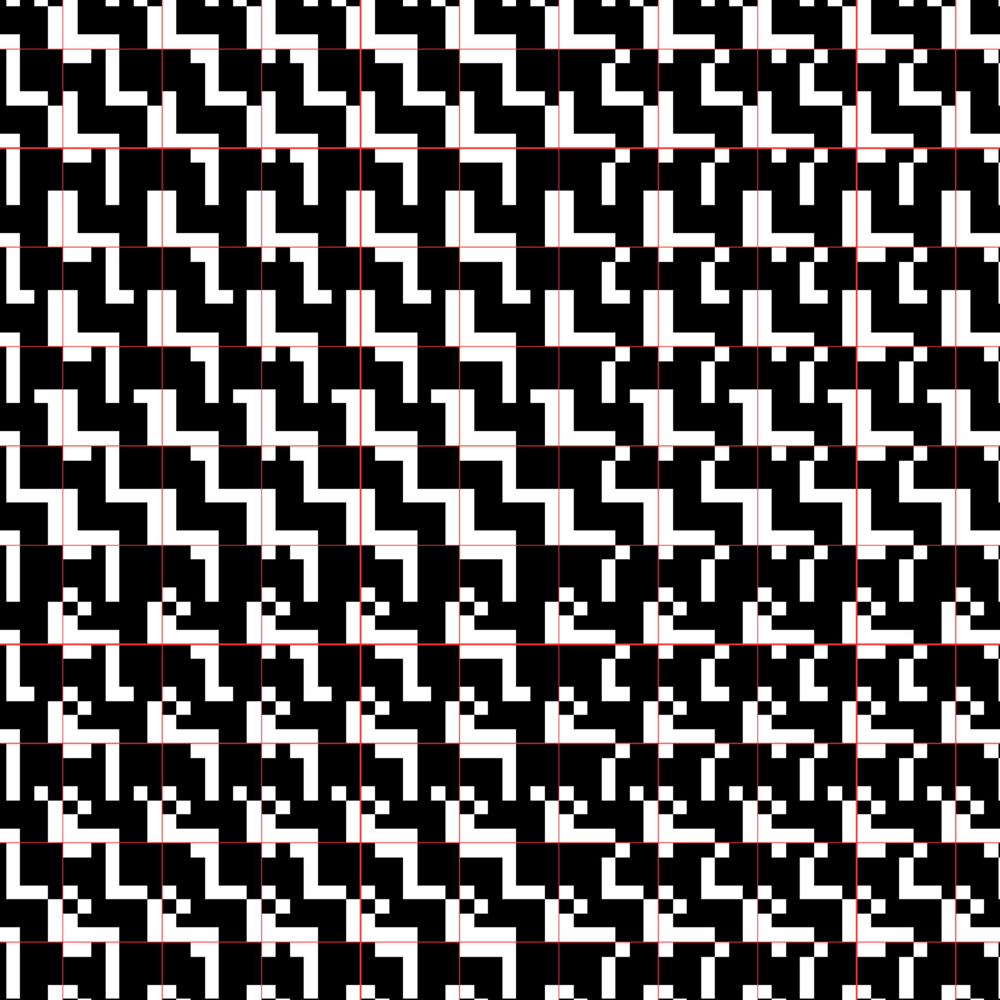
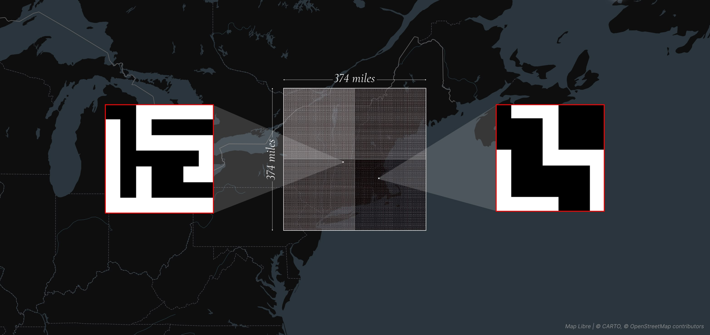

# Every 7×7 Binary Grid

An interactive canvas containing all **562,949,953,421,312** possible 7×7 black-and-white patterns. Every pattern has its own location: pan and zoom to explore, draw a pattern to jump straight to it, or visit MIT Media Lab research group glyphs through presets and an animated tour.

[Explore the project](https://7x7.yufeng.place) · [Read the project post](https://www.yufengzhao.com/projects/every-7x7-binary-grid)

Built with JavaScript and WebGL, using a quadtree layout and origin shifting to navigate the enormous coordinate space. Open `index.html` in a browser to run locally.

